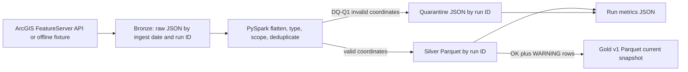

# Architecture

## Decisions
- Bronze is append-by-run for traceability.
- Silver is typed and deduplicated by `chapter_id`.
- Gold is overwritten as a current v1 snapshot, making reruns idempotent.
- Quarantine preserves the raw feature JSON and reason code.
- The fixture enables deterministic offline review; `--source api` exercises the live endpoint.
